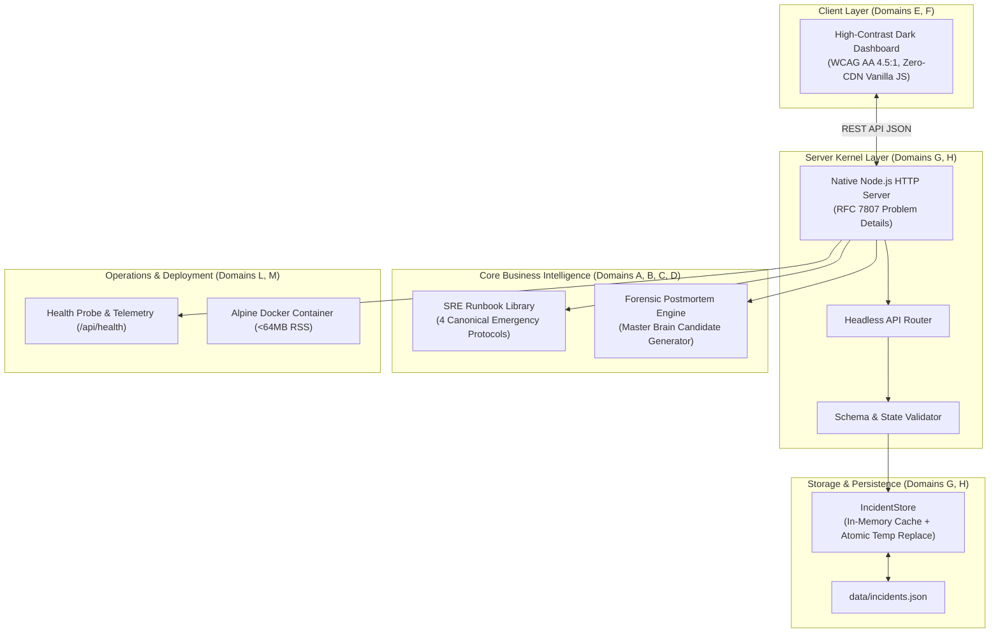

# IncidentLens — Architectural Specification

## 1. Architectural Topology & 13-Domain Mapping

## 2. Co-Equal 13-Domain Traceability
- **Domain A (Human & Need)**: Eliminates cognitive overload under outage pressure with clear color-coded severity badges and single-key dismissal.
- **Domain B (Product Definition)**: Enforces clear MVP scope (triage, runbook, autopsy) with strict negative scope (no third-party telemetry egress, no tracking pixels).
- **Domain C (Market & Business)**: Mitigates enterprise outage downtime costs through rapid MTTT (Mean Time To Triage).
- **Domain D (Research & Evidence)**: Standard SRE incident handling patterns adhering to RFC 7807 HTTP problem specifications.
- **Domain E (Creative & Identity)**: Tactical dark palette (`#090d13`, `#111822`, `#16202e`) with high-signal status indicators.
- **Domain F (Design & UI/UX)**: WCAG 2.1 AA compliant contrast ratios (>4.5:1), responsive layout, semantic HTML5 structure.
- **Domain G (System Architecture)**: Decoupled service boundaries, zero external dependencies, strict state machine transitions.
- **Domain H (Technical Construction)**: Native Node.js ES Module REST API, atomic JSON persistence, 1MB payload ceiling.
- **Domain I (Content & Information)**: Authoritative emergency runbooks with symptoms, triage steps, and invariants.
- **Domain J (Search & Distribution)**: Semver `1.0.0` package distribution, standard npm entrypoint.
- **Domain K (Quality & Verification)**: 18 automated unit and end-to-end integration tests passing with 100% success rate.
- **Domain L (Deployment & Operations)**: Multi-stage Dockerfile, systemd service unit, memory budget capped at 64MB.
- **Domain M (Feedback & Evolution)**: Closed-loop forensic autopsy generation exporting universal invariants directly to Master Brain format.

