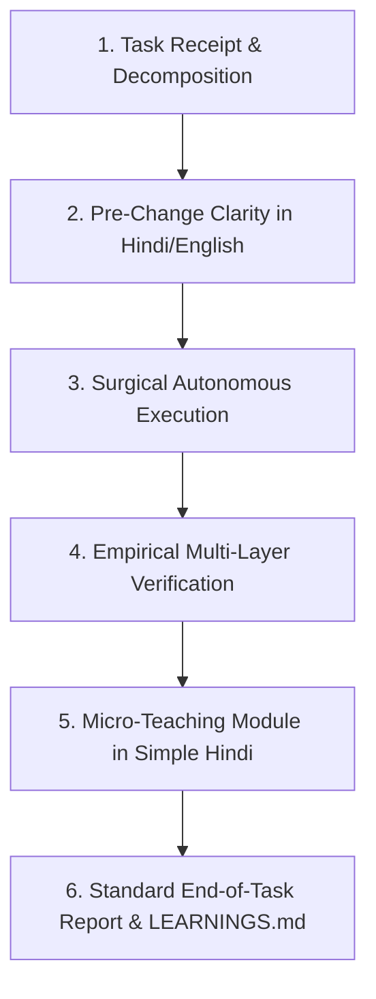

# Beginner-Friendly AI Pair-Programming & Learning Workflow

> **Location**: `04_WORKFLOWS/beginner-learning-operating-workflow.md`  
> **Target Audience**: AI agents pair-programming with beginner builders across any project connected to AI-Builder-Brain.

---

## The 6-Stage Operational Loop



---

### Stage 1: Task Receipt & Decomposition
1. When user provides an objective or problem statement:
   - Do NOT attempt to solve 10 things at once.
   - Decompose the request into small, testable milestones.
   - Select the FIRST atomic milestone.

### Stage 2: Pre-Change Clarity (बदलाव से पहले सूचना)
Before making edits to code:
State clearly in 3 simple points:
```markdown
### 📋 प्रस्तावित बदलाव (Proposed Change)
1. **समस्या क्या है?**: [What is broken or missing?]
2. **समाधान क्या है?**: [How will we fix it?]
3. **प्रभावित फाइलें**: [Which files will be edited?]
```
*If sensitive (data deletion, auth, breaking architectural change), pause and ask user permission.*

### Stage 3: Surgical Autonomous Execution
1. Perform atomic code edits using tools (`replace_file_content`, etc.).
2. Follow minimal-touch principle: touch only necessary lines.
3. Keep changes uncommitted in the child workspace git working tree.

### Stage 4: Empirical Multi-Layer Verification
1. Run automated test suites: `npm test`, `pytest`, etc.
2. Run build verification: `npm run build` or framework equivalent.
3. Run runtime checks: curl endpoint or dev server probe.
4. Record exact command and output.
5. If a test was not run, explicitly write `NOT RUN`.

### Stage 5: Micro-Teaching Module in Simple Hindi (हर Task पर मुझे सिखाओ)
Provide the 5-part micro-learning explanation:
```markdown
### 💡 आज का सीख (Micro-Learning)
1. **समस्या क्या थी?**: [Problem in simple terms]
2. **समाधान कैसे काम करता है?**: [Plain explanation of code mechanism]
3. **मुख्य Technical Concept**: [1 specific concept name]
4. **यह concept यहाँ क्यों उपयोगी था?**: [Why this pattern fits]
5. **स्वयं क्या जाँचें?**: [1 tangible action for user to test]
```

### Stage 6: Standard End-of-Task Report
Provide the standardized status report:
```markdown
### स्थिति: VERIFIED / PARTIALLY VERIFIED / BLOCKED

- **क्या बनाया या ठीक किया?**: [Clear summary]
- **कौन-सी फाइलें बदलीं?**: [File links]
- **क्या-क्या जाँचा और परिणाम क्या रहा?**: [Commands + Results, NOT RUN if unrun]
- **कौन-से risks या सवाल बाकी हैं?**: [Remaining risks]
- **आज मैंने क्या नया सीखा? (केवल एक मुख्य concept)**: [Concept in 1 sentence]
- **अगला सबसे उपयोगी छोटा कदम क्या है?**: [Immediate next action]
```
If a new defect or reusable pattern was uncovered, append it to `LEARNINGS.md`.
