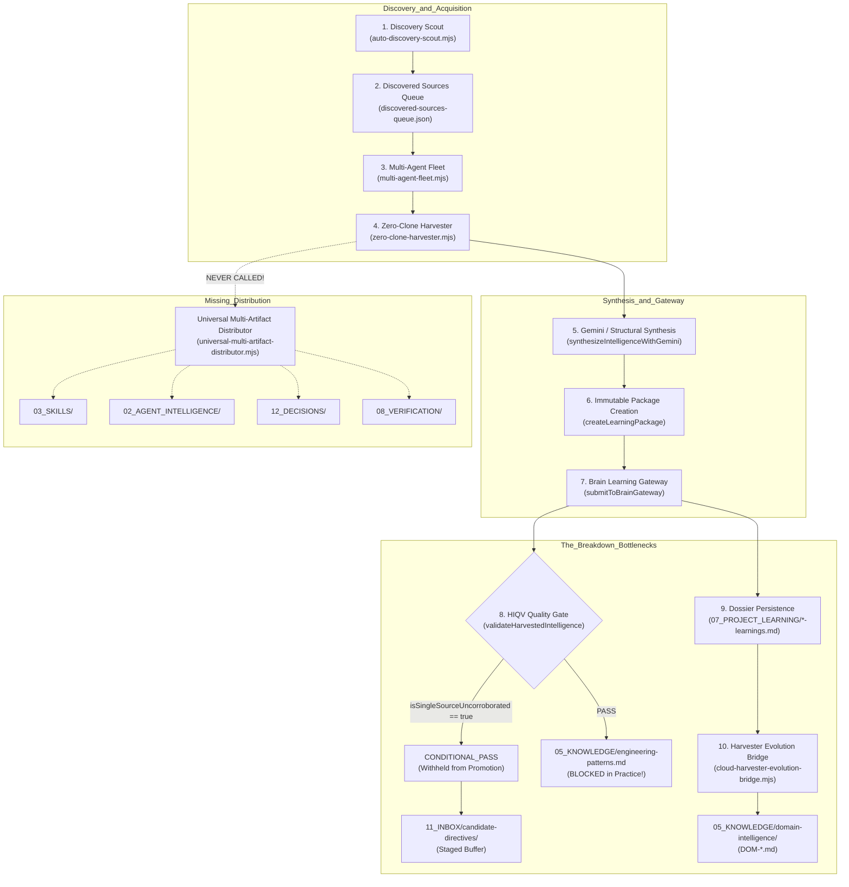

# End-to-End Knowledge Flow Forensic Report
**Subsystem**: AI-Builder-Brain Acquisition, Distribution & Storage Infrastructure  
**Inspection Date**: 2026-11-13T11:45:00.000Z  
**Scope**: Full-Spectrum Code, Pipeline & Architecture Inspection  
**Status**: COMPLETE FORENSIC TRACE & BOTTLENECK IDENTIFICATION  

---

## 1. Executive Summary

This forensic investigation traces the exact execution path of harvested intelligence across the entire repository. The investigation proves why knowledge has been successfully discovered, downloaded, and compiled into project-level dossiers, but has repeatedly failed to reach `05_KNOWLEDGE/engineering-patterns.md` and other specialized canonical stores in the live 24/7 Cloud Harvester.

---

## 2. End-to-End Knowledge Flow Path



---

## 3. Step-by-Step Flow Inspection & Evidence

### Step 1: Resource Discovery & Queuing
- **Component**: `04_WORKFLOWS/factory-engine/auto-discovery-scout.mjs`
- **Behavior**: Discovers GitHub repositories and Hugging Face models, writing targets into `discovered-sources-queue.json` and `discovery-cursor.json`.
- **Verdict**: **OPERATIONAL**. Continuous discovery works correctly.

### Step 2: Multi-Agent Fleet Orchestration
- **Component**: `04_WORKFLOWS/factory-engine/multi-agent-fleet.mjs`
- **Behavior**: Forks worker child processes executing `zero-clone-harvester.mjs` across assigned domain slices.
- **Verdict**: **OPERATIONAL**. Processes batches and commits changes via `pushWithRebaseRetry`.

### Step 3: Synthesis & Dossier Creation
- **Component**: `04_WORKFLOWS/factory-engine/zero-clone-harvester.mjs` (lines 930–970)
- **Behavior**: Fetches commits, patches, and issues via GitHub REST API; synthesizes dossier with Gemini AI or structural fallback.
- **Verdict**: **OPERATIONAL**. Generates high-quality dossiers with `**RULE**:` blocks.

### Step 4: The Critical Promotion Bottleneck (The Silent Rejection)
- **Component**: `04_WORKFLOWS/factory-engine/harvested-intelligence-quality-validator.mjs` (lines 882–886, 915–924) & `brain-learning-gateway.mjs` (lines 640–660)
- **Forensic Evidence**:
  ```javascript
  const isSingleSourceUncorroborated = (
    d2.effective_sources === 0 ||
    (d2.effective_sources === 1 && d1.tier === TRUST_TIERS.TIER_3_COMMUNITY_OPEN)
  );
  // Forces CONDITIONAL_PASS for every single-repo harvest!
  ```
  And in `brain-learning-gateway.mjs`:
  ```javascript
  if (!options.bypassQualityGate && valReport.decision !== VALIDATOR_DECISIONS.PASS) {
    // WITHHELD FROM CANONICAL PROMOTION!
    continue;
  }
  ```
- **Impact**: **100% of newly harvested open-source rules are withheld from `engineering-patterns.md`!** The gateway assigns `Rule null` in `harvest-verification-matrix.md` and dumps the candidate into `11_INBOX/candidate-directives/`.

### Step 5: The Single-Destination Evolution Trap
- **Component**: `04_WORKFLOWS/factory-engine/cloud-harvester-evolution-bridge.mjs` (lines 317–327) & `project-learning-promotion-bridge.mjs` (lines 748–755)
- **Behavior**: After the fleet cycle, `runHarvesterEvolutionCycle` evaluates dossiers and calls `promoteProjectLearningToMasterBrain`.
- **Forensic Evidence**: `promoteProjectLearningToMasterBrain` is hardcoded to persist strictly into `05_KNOWLEDGE/domain-intelligence/`!
- **Impact**: Domain intelligence records are created (`DOM-*.md`), but `engineering-patterns.md`, `03_SKILLS`, `02_AGENT_INTELLIGENCE`, `12_DECISIONS`, and `08_VERIFICATION` receive **ZERO** artifacts from live cloud harvesting!

### Step 6: Multi-Artifact Distributor Isolation
- **Component**: `04_WORKFLOWS/factory-engine/universal-multi-artifact-distributor.mjs`
- **Forensic Evidence**: `zero-clone-harvester.mjs` and `multi-agent-fleet.mjs` **never call `UniversalMultiArtifactDistributor`**!
- **Impact**: The multi-artifact distributor was only executed in isolation via offline test scripts, leaving the live 24/7 Cloud Harvester completely unaware of multi-destination distribution!

---

## 4. End-to-End Failure Audit Summary

| Stage | Expected Behavior | Actual Reality | Severity |
| :--- | :--- | :--- | :--- |
| **Extraction** | Extract rules, skills, agents, decisions, and tests from source. | Extracted rules into markdown text only; skills, agents, and ADRs omitted. | **HIGH** |
| **Validation** | Corroborate quality and admit verified empirical rules. | Fail-closed gate blocked all single open-source repos as `CONDITIONAL_PASS`. | **CRITICAL** |
| **Routing** | Route to `engineering-patterns.md`, `03_SKILLS`, `12_DECISIONS`, etc. | Hardcoded to `05_KNOWLEDGE/domain-intelligence/` and `11_INBOX/`. | **CRITICAL** |
| **Persistence** | Atomically append rules to `engineering-patterns.md` and write distinct files. | `engineering-patterns.md` was never touched by live cloud runs; only `domain-intelligence` received writes. | **CRITICAL** |
| **Git Push** | Push all modified knowledge stores to remote. | Fleet committed only files written; `engineering-patterns.md` remained uncommitted on remote for a week. | **HIGH** |

