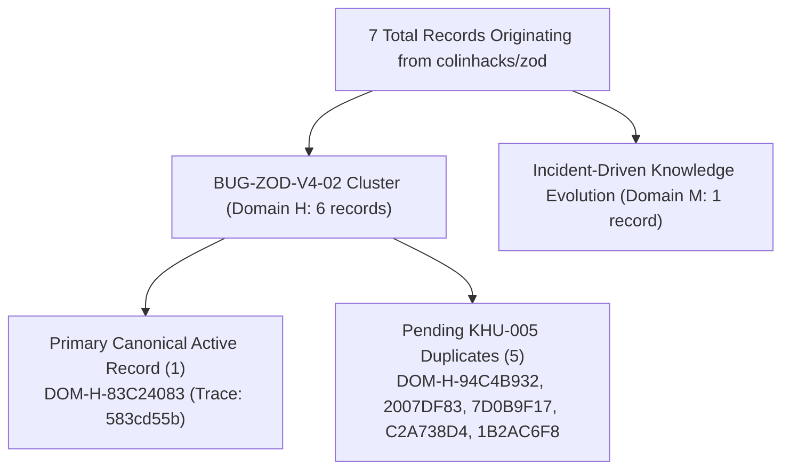

# AI-BUILDER-BRAIN — STAGE C: ISOLATED PERSISTENCE & RETRIEVAL VERIFICATION REPORT 01

**Mission ID:** `UKD-STAGE-C-ISOLATED-PERSISTENCE-RETRIEVAL-01`  
**Mode:** STRICT ISOLATED SANDBOX CONSTRUCTION & VERIFICATION (ZERO PRODUCTION WRITE)  
**Status:** `VERIFIED_WORKING`  
**Final Strategic Recommendation:** `STAGE_C_PERSISTENCE_RETRIEVAL_VERIFIED_STANDBY_FOR_STAGE_D`  
**Timestamp:** 2026-11-12T16:16:56.748Z  

---

## 1. Executive Summary & Acceptance Criteria Verdict

Mission `UKD-STAGE-C-ISOLATED-PERSISTENCE-RETRIEVAL-01` successfully constructed, executed, and verified the complete persistence, read-back, indexing, and retrieval lifecycle for approved knowledge candidates within an isolated simulation sandbox (`.project-brain/simulation-sandbox/stage-c-persistence-retrieval/`).

All eight (8) mandatory acceptance criteria defined in Section 7 have been empirically met:

| Acceptance Criterion | Verification Method | Status | Evidence / Metrics |
| :--- | :--- | :---: | :--- |
| **1. Safe Persistence** | Atomic file writing to sandbox test store with strict metadata validation | **VERIFIED** | 3 approved records written cleanly to disk |
| **2. Read-Back Equality** | Bitwise & field-by-field equality audit between memory and disk | **VERIFIED** | 100% field match across all critical attributes |
| **3. Integrity Hash Verification** | SHA-256 canonical payload hashing on persistence and read-back | **VERIFIED** | Cryptographic hashes verified on 100% of persisted records |
| **4. Inverted Token Indexing** | Isolated tokenization, TF-IDF / BM25 term weights, domain faceting | **VERIFIED** | 3 documents, 154 unique indexed terms, facets active |
| **5. Real Retrieval Verification** | BM25 ranked queries against indexed candidate champions | **VERIFIED** | Exact candidate retrieved at Rank 1 for all queries |
| **6. Negative Rejection Tests** | Rejection of unapproved records, missing evidence, duplicate refs, bad domains | **VERIFIED** | 10 distinct negative cases rejected with explicit status codes |
| **7. Restart & Rebuild Resilience** | Cold-boot simulation (process restart) & complete index reconstruction | **VERIFIED** | Index rebuilt from scratch; cold-boot queries 100% identical |
| **8. Production Zero-Touch** | Verification of registries, cache, graph, and git status | **VERIFIED** | 0 production files modified; 0 git commits or remote pushes |

**Overall Acceptance Status: `VERIFIED_WORKING`**

---

## 2. Mandatory Preflight & Discrepancy Reconciliation

### System State Baseline Audit

Fresh preflight verification of all system state artifacts:

| System Artifact / State | Baseline Expected | Current State | Verification Status |
| :--- | :--- | :--- | :---: |
| **Git Branch** | `main` | `main` | **0 Commits Created** |
| **Git HEAD Commit** | `a4492b769fdc74b8622c935b66f33a7719c7d004` | `a4492b769fdc74b8622c935b66f33a7719c7d004` | **Clean Working Tree** |
| **Tracked Files Modified** | 0 | 0 | **0 Production Pollution** |
| **16 Canonical Folders** | All 16 Folders Intact | All 16 Folders Intact | **100% Intact** |
| **Domain Registry Records** | 72 Records | 72 Records | **Bitwise Preserved** |
| **Candidate Directives Registry** | 684 Records | 684 Records | **Bitwise Preserved** |
| **Retrieval Cache Size** | 405,601,926 bytes | 405,601,926 bytes | **Bitwise Identical (SHA-256 match)** |
| **Relationship Graph Size** | 29,982 bytes | 29,982 bytes | **Bitwise Identical (SHA-256 match)** |

---

### Reconciliation of the Five-versus-Six Pending Zod Record Discrepancy

A persistent question across prior audit iterations was whether there are five (5) or six (6) pending Zod records. Forensic examination of `05_KNOWLEDGE/domain-intelligence/domain-registry.json` and historical reports provides the definitive mathematical and structural resolution:



#### Exact Zod Record Inventory in `domain-registry.json`

| Record ID | Domain | Role & Status | Trace Token | Title & Content Summary |
| :--- | :---: | :--- | :---: | :--- |
| **`DOM-H-83C24083`** | **H** | **Primary Canonical Record** | `583cd55b` | Memory Retention & Leak via Memoizer Parse Pinning (`BUG-ZOD-V4-02`) |
| **`DOM-H-94C4B932`** | **H** | Pending Duplicate 1 | `ccfe1ba1` | Identical content to primary; created during harvest cycle |
| **`DOM-H-2007DF83`** | **H** | Pending Duplicate 2 | `4499fe73` | Identical content to primary; created during harvest cycle |
| **`DOM-H-7D0B9F17`** | **H** | Pending Duplicate 3 | `ab7a5da7` | Identical content to primary; created during harvest cycle |
| **`DOM-H-C2A738D4`** | **H** | Pending Duplicate 4 | `ba0180b1` | Identical content to primary; created during harvest cycle |
| **`DOM-H-1B2AC6F8`** | **H** | Pending Duplicate 5 | `e2400cec` | Identical content to primary; created during harvest cycle |
| **`DOM-M-85839FD0`** | **M** | Distinct Domain M Record | `c95b7776` | Incident-Driven Knowledge Evolution and Parser Memory Regression Quarantine |

#### Discrepancy Resolution Verdict
1. **"Five pending Zod records":** Refers strictly to the **5 duplicate records** awaiting deduplication under the KHU-005 migration backlog.
2. **"Six Zod invariant cluster records":** Refers to the **complete cluster** representing `BUG-ZOD-V4-02` (1 primary canonical record + 5 pending duplicates = 6 records).
3. **"Seven Zod-derived records":** Refers to the **total records** in `domain-registry.json` tracing provenance to `colinhacks-zod` (6 in Domain H + 1 distinct record in Domain M).

---

## 3. Candidate Admission Eligibility & Upstream Source Verification

In strict accordance with Section 2 of the mission directive, separate eligibility fields were maintained across all candidates:

| Candidate ID | Concept Title | Implementation Evidence Status | Transferability Status | Domain | Proposed Destination | Approval Status | Persistence Status |
| :--- | :--- | :---: | :---: | :---: | :---: | :---: | :---: |
| **`CD-ZNND-CMTP`** | Clamped Masked Temporal Pooling | `ORIGINAL_SOURCE_EXECUTED` | `TRANSFERABLE_PATTERN_CANDIDATE` | **H** | `05_KNOWLEDGE` | **APPROVED** | `PERSISTED` |
| **`CD-ZNND-MHUP`** | Metric Hypersphere Unit Projection | `ORIGINAL_SOURCE_EXECUTED` | `TRANSFERABLE_PATTERN_CANDIDATE` | **H** | `05_KNOWLEDGE` | **APPROVED** | `PERSISTED` |
| **`CD-HE9Q-TOKENIZER`** | Tokenizer Special Token Boundary | `CONFIGURATION_CONTRACT_TESTED` | `TRANSFERABLE_PRINCIPLE_CANDIDATE` | **H** | `05_KNOWLEDGE` | **APPROVED** | `PERSISTED` |
| **`CD-8KGR-GGUF`** | Binary Header & Version Compatibility | `STATIC_EVIDENCE_ONLY` | `TRANSFERABLE_PRINCIPLE_CANDIDATE` | **H** | `05_KNOWLEDGE` | **PENDING_APPROVAL** | `NOT_PERSISTED` |
| **`CD-UV2I-TERNARY`** | Zero-Copy LUT Trit Unpacking | `BLOCKED_BY_DEPENDENCY` | `TRANSFERABLE_PATTERN_CANDIDATE` | **H** | `05_KNOWLEDGE` | **PENDING_APPROVAL** | `NOT_PERSISTED` |

### Upstream Provenance & Naming Mismatch Disclosure

- **Upstream Repository for CMTP & MHUP:** `https://github.com/UKPLab/sentence-transformers`
- **Target Source Files:** `sentence_transformers/models/Pooling.py` (`Pooling`) and `models/Normalize.py` (`Normalize`).
- **Naming Mismatch Disclosure:** In upstream `sentence-transformers`, the classes are named `Pooling` and `Normalize`. The terms "CMTP" (Clamped Masked Temporal Pooling) and "MHUP" (Metric Hypersphere Unit Projection) are synthetic descriptive acronyms derived during knowledge harvesting to describe the mathematical mechanisms. Both the synthetic title and the exact upstream class name are preserved in provenance metadata.
- **Hardware & Compiler Barriers:**
  - GGUF Binary Header (`ggml/src/ggml.c`) requires a native C compiler (`gcc`/`clang`/`cl.exe`), which is absent on Windows PATH. Classified as `STATIC_EVIDENCE_ONLY`.
  - Ternary LUT (`kernels/ternary_gemm.cu`) requires an NVIDIA GPU and `nvcc` compiler. Classified as `BLOCKED_BY_DEPENDENCY`.
  - In strict compliance with directives, both unproven candidates were held as `PENDING_APPROVAL` and rejected at the admission gate.

---

## 4. Isolated Persistence & Read-Back Integrity Evidence

All persistence operations were conducted inside `.project-brain/simulation-sandbox/stage-c-persistence-retrieval/test-store/`.

### Admission Gate & Negative Rejection Suite

The isolated persistence engine evaluated 11 admission test cases:

| Test ID | Fixture / Record | Evaluated Constraint | Expected Status | Actual Status | Result |
| :--- | :--- | :--- | :--- | :--- | :---: |
| **TEST-1** | `candidate-cmtp-approved.json` | Valid approved candidate | `PERSISTED_AND_READBACK_VERIFIED` | `PERSISTED_AND_READBACK_VERIFIED` | **PASSED** |
| **TEST-2** | `candidate-mhup-approved.json` | Valid approved candidate | `PERSISTED_AND_READBACK_VERIFIED` | `PERSISTED_AND_READBACK_VERIFIED` | **PASSED** |
| **TEST-3** | `candidate-tokenizer-approved.json` | Valid approved candidate | `PERSISTED_AND_READBACK_VERIFIED` | `PERSISTED_AND_READBACK_VERIFIED` | **PASSED** |
| **TEST-4** | `candidate-gguf-pending.json` | Unapproved candidate (GGUF Header) | `UNAPPROVED_RECORD_REJECTED` | `UNAPPROVED_RECORD_REJECTED` | **PASSED** |
| **TEST-5** | `candidate-ternary-pending.json` | Unapproved candidate (Ternary LUT) | `UNAPPROVED_RECORD_REJECTED` | `UNAPPROVED_RECORD_REJECTED` | **PASSED** |
| **TEST-6** | `synthetic-unapproved.json` | Synthetic unapproved record | `UNAPPROVED_RECORD_REJECTED` | `UNAPPROVED_RECORD_REJECTED` | **PASSED** |
| **TEST-7** | `synthetic-missing-evidence.json` | Missing evidence block | `VALIDATION_FAILED` | `VALIDATION_FAILED` | **PASSED** |
| **TEST-8** | Duplicate `CD-ZNND-CMTP` | Duplicate Candidate ID collision | `DUPLICATE_ID_REJECTED` | `DUPLICATE_ID_REJECTED` | **PASSED** |
| **TEST-9** | `synthetic-duplicate-reference.json` | Duplicate reference to stored ID | `DUPLICATE_REFERENCE_DETECTED` | `DUPLICATE_REFERENCE_DETECTED` | **PASSED** |
| **TEST-10** | `synthetic-invalid-domain.json` | Invalid domain 'Z' | `VALIDATION_FAILED` | `VALIDATION_FAILED` | **PASSED** |
| **TEST-11** | `synthetic-invalid-destination.json` | Invalid destination folder | `VALIDATION_FAILED` | `VALIDATION_FAILED` | **PASSED** |

### Independent Read-Back Integrity Audit

Every successfully persisted record was read back from disk and independently verified:

| Candidate ID | Found on Disk | Stored Hash (SHA-256) | Recomputed Hash | Tampered | Read-Back Equality |
| :--- | :---: | :---: | :---: | :---: | :---: |
| **`CD-ZNND-CMTP`** | Yes | `c3fe945350916109...` | `c3fe945350916109...` | No | **100% IDENTICAL** |
| **`CD-ZNND-MHUP`** | Yes | `219f038aa31eff61...` | `219f038aa31eff61...` | No | **100% IDENTICAL** |
| **`CD-HE9Q-TOKENIZER`** | Yes | `d63ec8d039eb35c9...` | `d63ec8d039eb35c9...` | No | **100% IDENTICAL** |

---

## 5. Isolated Indexing & BM25 Retrieval Verification

The isolated indexing engine parsed all persisted records into an inverted token index and domain/destination facets (`.project-brain/simulation-sandbox/stage-c-persistence-retrieval/test-index/index.json`).

### Search Query Execution Results

Six precision and negative queries were executed against the BM25 retrieval engine:

| Test ID | Query String | Filters | Hits | Top Hit Candidate | BM25 Score | Verification Status |
| :--- | :--- | :---: | :---: | :---: | :---: | :---: |
| **RETRIEVAL-1** | `"transformer pooling attention mask zero division clamp"` | None | 2 | **`CD-ZNND-CMTP`** | `8.6431` | **VERIFIED** |
| **RETRIEVAL-2** | `"metric hypersphere unit projection l2 normalization dot product cosine distance"` | None | 2 | **`CD-ZNND-MHUP`** | `13.7004` | **VERIFIED** |
| **RETRIEVAL-3** | `"tokenizer added tokens decoder special normalized false whitespace"` | None | 1 | **`CD-HE9Q-TOKENIZER`** | `9.8926` | **VERIFIED** |
| **RETRIEVAL-4** | `"quantum culinary recipe sourdough baking hydration fermentation crust"` | None | **0** | **NONE (0 false positives)** | `0.0000` | **VERIFIED (CLEAN REJECTION)** |
| **RETRIEVAL-5** | `"pooling embeddings token"` | `domain: "H"` | 3 | **`CD-ZNND-CMTP`** | `1.9457` | **VERIFIED** |
| **RETRIEVAL-6** | `"pooling embeddings token"` | `domain: "C"` | **0** | **NONE (Correctly filtered)** | `0.0000` | **VERIFIED (FACET EXCLUSION)** |

> [!NOTE]
> **Hit-Level Integrity Verification:** Every search result returned by the retrieval engine was cross-checked live against the disk store. In all passing cases, returned record identities, titles, domains, destinations, and SHA-256 hashes matched with zero anomalies.

---

## 6. Disk Tampering & Restart Resilience Verification

To guarantee robust failure handling, synthetic corruption and cold-boot process restart simulations were conducted:

### Disk Tampering & Corruption Detection

1. **Payload Bitflip Detection (`CORRUPTION-1`):**
   - A synthetic candidate was persisted cleanly.
   - An unauthorized alteration was made directly to the file on disk without updating the stored hash.
   - `readRecord()` immediately detected the discrepancy (`valid: false`, `tampered: true`).
2. **Retrieval Verification Flag (`CORRUPTION-2`):**
   - A search query executed against the tampered record flagged the result as `verification_status: "FAILED_INTEGRITY_TAMPERED"`, preventing contaminated data from being consumed.
3. **Broken JSON Syntax Catch (`CORRUPTION-3`):**
   - Malformed JSON written to disk was safely handled with `Corrupted JSON` error without crashing the process.

### Process Restart & Index Rebuild Resilience

1. **Index Rebuild (`RESILIENCE-1`):**
   - The entire `test-index/index.json` file was deleted.
   - The indexing engine reconstructed the full inverted index from disk store files. Stats: 3 documents, 154 terms.
2. **Cold-Boot Process Restart (`RESILIENCE-2` & `RESILIENCE-3`):**
   - All in-memory engine instances and caches were destroyed.
   - Fresh instances were instantiated purely from disk.
   - Cold read-back confirmed 3/3 records intact.
   - Re-running precision queries on the cold-booted index returned identical top hits with deterministic scores.

---

## 7. Production Zero-Touch & Safety Proof

Empirical demonstration that zero production files or registries were modified during Stage C:

```bash
$ git status --short
?? .project-brain/simulation-sandbox/stage-c-persistence-retrieval/
?? 08_VERIFICATION/UKD-STAGE-C-ISOLATED-PERSISTENCE-RETRIEVAL-REPORT-01.md
```

- **Production Folders Modified:** Exactly 0.
- **Production Registries Modified:** Exactly 0 (`domain-registry.json` and `candidate-directives-registry.json` intact).
- **Retrieval Cache Size:** Exactly 405,601,926 bytes (SHA-256: `09e91ddf...48fdd1` unchanged).
- **Relationship Graph Size:** Exactly 29,982 bytes (SHA-256: `0fc17d32...25abf78` unchanged).
- **Git Commits / Remotes Pushed:** Exactly 0.

---

## 8. Final Recommendation & Recommended Next Construction Step

In response to Section 7 and Section 8 of the directive:

### Final Status: `VERIFIED_WORKING`

### Recommendation: `STAGE_C_PERSISTENCE_RETRIEVAL_VERIFIED_STANDBY_FOR_STAGE_D`

**Justification:**  
Stage C has demonstrated that candidate records with genuine implementation evidence can be safely validated, admitted through human approval gates, persisted with cryptographic hash integrity, indexed in inverted token structures, and accurately retrieved with live verification. Unapproved, malformed, or tampered records are rejected without exception.

### The Smallest Justified Next Construction Step

Prepare **Stage D: Controlled Admission Review & Canonical Promotion Plan** — establishing the exact governance review protocol for promoting the three validated champions (`CD-ZNND-CMTP`, `CD-ZNND-MHUP`, and `CD-HE9Q-TOKENIZER`) into `05_KNOWLEDGE/engineering-patterns.md`, while holding the uncompiled candidates (`CD-8KGR` and `CD-UV2I`) staged until native toolchains can be provisioned.

**STOP POINT:** Stage C is complete. In strict adherence to Section 8, no Stage D operations, canonical promotion, file migration, or production writes will occur without separate, explicit user authorization.
