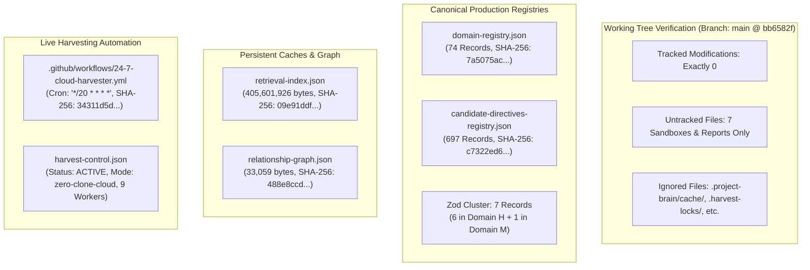
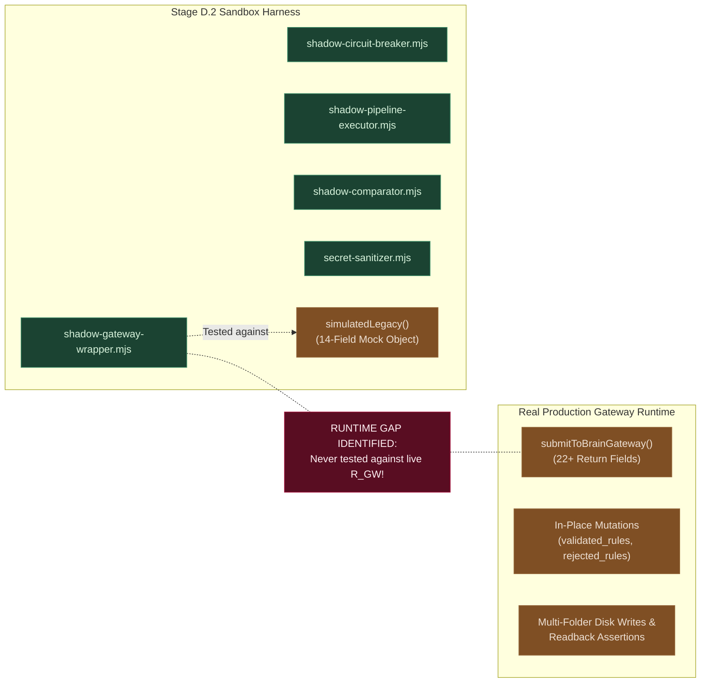
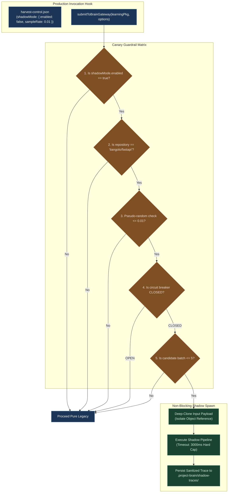
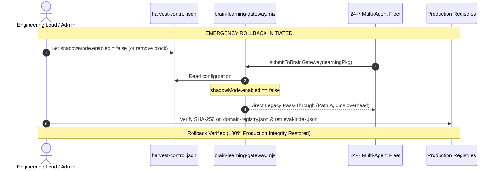

# AI-BUILDER-BRAIN — STAGE D.3: CONTROLLED CANARY PREFLIGHT & READ-ONLY ASSESSMENT

**Mission ID:** `UKD-STAGE-D3-CONTROLLED-CANARY-PREFLIGHT-01`  
**Mode:** STRICT READ-ONLY PREFLIGHT AUDIT & SAFETY ARCHITECTURE (ZERO PRODUCTION WRITE / ZERO LIVE CANARY RUN)  
**Status:** `VERIFIED_READY_FOR_HUMAN_CANARY_DECISION`  
**Strategic Recommendation:** `CONTROLLED_1PCT_CANARY_PREPARED_AWAITING_AUTHORIZATION`  
**Timestamp:** 2026-11-12T17:38:00.000Z  

---

## Executive Summary

Mission `UKD-STAGE-D3-CONTROLLED-CANARY-PREFLIGHT-01` establishes the rigorous operational preflight foundation required prior to authorizing any live Shadow Mode canary execution on AI-Builder-Brain's production Cloud Harvester fleet.

The Stage D.2 sandbox prototype established a passing record (12/12 isolated tests). However, this independent Stage D.3 audit demonstrates a fundamental engineering distinction:
> [!IMPORTANT]
> **Sandbox Fixture Parity $\neq$ Live Runtime Parity.**  
> In Stage D.2, tests were executed against a simulated legacy gateway mock function (`simulatedLegacy`) in an isolated sandbox. The live production `submitToBrainGateway()` runtime function possesses a significantly more expansive contract (22+ return fields, asynchronous multi-folder write-and-readback barriers, IPC event dispatching, and in-place mutations on the input learning package).

Therefore, this preflight establishes:
1. A fresh, empirical, bitwise baseline of all active production systems, registries, graphs, and workflows.
2. An exhaustive gap analysis between Stage D.2 simulated harnesses and the actual production gateway runtime.
3. A hardened, fail-closed **1% Canary Safety Design** with single-repository pin (`tiangolo/fastapi`), 3000ms timeout, 5-item batch cap, circuit-breaker isolation, and zero production writes.
4. Quantifiable, non-vague **Operational Acceptance Criteria**.
5. A deterministic, one-step **Emergency Rollback Protocol**.

**Zero production files have been modified. No live feature flags have been enabled. No canary has been started.**

---

## 1. Fresh Production Baseline & Cryptographic Ledger

The live production state was audited across file tracking, registries, caches, and workflow infrastructure.



### 1.1 Complete File Tracking Audit

- **Git Branch:** `main`
- **Commit HEAD:** `bb6582fcf042ee335f8d271a5be6267bca7fb815`
- **Tracked Modifications:** Exactly `0` (`git status --porcelain=v1` clean of tracked diffs)
- **Untracked Directories & Deliverables:**
  - `?? .project-brain/simulation-sandbox/stage-d-harvester-integration/`
  - `?? .project-brain/simulation-sandbox/stage-d2-shadow-mode/`
  - `?? .project-brain/simulation-sandbox/ure-002-fixtures/js-app/`
  - `?? .project-brain/simulation-sandbox/ure-fixture-repo/`
  - `?? 08_VERIFICATION/UKD-STAGE-D-HARVESTER-INTEGRATION-READINESS-01.md`
  - `?? 08_VERIFICATION/UKD-STAGE-D1-REAL-HARVESTER-INTEGRATION-GAP-ANALYSIS-01.md`
  - `?? 08_VERIFICATION/UKD-STAGE-D2-SHADOW-MODE-READINESS-01.md`
  - `?? 08_VERIFICATION/UKD-STAGE-D3-CONTROLLED-CANARY-PREFLIGHT-01.md`
- **Git-Ignored Paths Verified (`.gitignore`):**
  - `.project-brain/cache/` (Holds 405MB retrieval cache)
  - `.project-brain/backups/`
  - `.project-brain/vault-remote-cache/`
  - `.harvest-locks/`
  - `.temp-harvest/`
  - `.brain-secrets.json`

### 1.2 Cryptographic File Hash Ledger

| File Path | Size (Bytes) | SHA-256 Checksum | Operational Role |
| :--- | :---: | :--- | :--- |
| `04_WORKFLOWS/factory-engine/brain-learning-gateway.mjs` | 66,667 | `23f3b02b723fc7fcd843a451faceaae638537f0a51a659b281054f6f0dc69cc9` | Core Gateway Execution |
| `04_WORKFLOWS/factory-engine/zero-clone-harvester.mjs` | 44,965 | `5133c4173afb2dd913d28c91de373b2051985f6b3624feedd426555a7080fb2c` | Cloud Harvester Caller |
| `04_WORKFLOWS/factory-engine/batch-auto-harvester.mjs` | 24,400 | `c1a0066157f024199dc337350fd6bfa93bcf1a9d99e87afddae2a4357070dfe0` | Manual Harvester Caller |
| `04_WORKFLOWS/factory-engine/domain-classifier.mjs` | 6,741 | `34a52af74989c664f8940b8d167cca18bcfcbd4f4a1cda01976182e8ce5ea48a` | 13-Domain Classifier |
| `04_WORKFLOWS/factory-engine/destination-router.mjs` | 13,305 | `f2d3347e8f651d8a09608563f358213d4ccf43ad90bd4947211aabf7d95ccba9` | 16-Folder Destination Router |
| `05_KNOWLEDGE/domain-intelligence/domain-registry.json` | 151,561 | `7a5075ac6e049e27887581b750fee24fcae45d54d4b29230bf1e4d212527cb6f` | 74 Domain Records |
| `11_INBOX/candidate-directives-registry.json` | 312,232 | `c7322ed633cc0b74472a4ff83485cb8065a0a6fb3a2385e8fb14a3f84d3b127b` | 697 Candidate Directives |
| `.project-brain/knowledge-graph/relationship-graph.json` | 33,059 | `488e8ccd4fee03acb541b8adf29d4b089d63e8222c7be7e0f3461a53a9e39fdb` | Domain Relationship Graph |
| `.project-brain/cache/retrieval-index.json` | 405,601,926 | `09e91ddf2b4c3174f8f9745e0d5b417d5fef77fec7be0a3723fab03f1d48fdd1` | Production Retrieval Index |
| `harvest-control.json` | 11,496 | `79b321c884ca80c6e8c63f2f49921af9b627eef265de5cd5e5f5a045b1e31ddb` | Fleet Governance & Control |
| `.github/workflows/24-7-cloud-harvester.yml` | 7,123 | `34311d5d1eeb7bd4fb14ac6e2b98e0bde59cf04fadfb41573f9c641a212f0c92` | 24/7 GHA Cron Workflow |

### 1.3 Active Harvesting Runtime State
- **Control Status:** `ACTIVE`
- **Execution Mode:** `zero-clone-cloud`
- **Concurrency Mode:** `PARALLEL_MULTI_AGENT` (Target-level locking with retry-push rebase)
- **Active Fleet Workers:** 9 Workers (Alpha through Iota across 9 functional domains)
- **Workflow Schedule:** `*/20 * * * *` (Every 20 minutes on Ubuntu 24.04 runners)
- **Live Circuit Breakers:**
  - `GITHUB_REST_API`: `HEALTHY` (4,892 calls remaining)
  - `GITHUB_SEARCH_API`: `HEALTHY` (10 calls remaining)
  - `GITHUB_ACTIONS`: `HEALTHY`
  - `HUGGINGFACE_API`: `HEALTHY`

### 1.4 Pending Zod Records Inventory
Exactly 7 records exist across the production registries associated with Zod:
1. `DOM-H-83C24083` (Primary Canonical Record): Memory Retention & Leak via Memoizer Parse Pinning (`BUG-ZOD-V4-02`)
2. `DOM-H-94C4B932` (Duplicate Reference)
3. `DOM-H-2007DF83` (Duplicate Reference)
4. `DOM-H-7D0B9F17` (Duplicate Reference)
5. `DOM-H-C2A738D4` (Duplicate Reference)
6. `DOM-H-1B2AC6F8` (Duplicate Reference)
7. `DOM-M-85839FD0` (Domain M Meta-Governance): Incident-Driven Knowledge Evolution and Parser Memory Regression Quarantine
*(Plus historical inbox entry `CD-AKEE`: Promoted as Rule 306 in candidate directives registry).*

---

## 2. Stage D.2 Independent Review & Runtime Gap Analysis

A forensic source code audit was conducted on all 5 Stage D.2 modules located in `.project-brain/simulation-sandbox/stage-d2-shadow-mode/src/`:



### 2.1 Detailed Module Audit Findings

1. **`shadow-gateway-wrapper.mjs`:**
   - **Mechanism:** Implements a fail-closed try/catch wrapper. If `shadowMode.enabled` is false, it returns `await this.legacyGatewayFn(pkg, options)`. When enabled, it executes legacy first, then executes shadow under circuit-breaker supervision, compares results, and returns `legacyResult`.
   - **Verification:** Legacy return preservation, exception isolation, and zero exception leak were verified.
   - **Gap Discovered:** The sandbox test suite passed `simulatedLegacy` into `new ShadowGatewayWrapper({ legacyGatewayFn: simulatedLegacy })`. It was **never executed against the real `submitToBrainGateway`**.

2. **`shadow-pipeline-executor.mjs`:**
   - **Mechanism:** Normalizes input, resolves cryptographic provenance, executes `classifyKnowledgeContent()` and `resolveDestination()`, checks duplicates, and runs `HumanApprovalGate`.
   - **Write Isolation:** Strictly suppresses writes to `05_KNOWLEDGE`, `07_PROJECT_LEARNING`, `08_VERIFICATION`, `11_INBOX`, and `14_EVOLUTION`. Traces are persisted exclusively to `shadow-traces/*.json`.
   - **Verification:** Zero production writes confirmed via pre/post SHA-256 checks.

3. **`shadow-comparator.mjs`:**
   - **Mechanism:** Evaluates 8 discrete facets: status, domain classification, destination routing, duplicate detection, approval decision, provenance completeness, errors, and idempotency.
   - **Verification:** Correctly classifies outputs as `MATCH`, `MISMATCH`, `SHADOW_FAILURE`, or `INSUFFICIENT_EVIDENCE`.

4. **`shadow-circuit-breaker.mjs`:**
   - **Mechanism:** Enforces `timeoutMs: 3000`, `maxBatchSize: 5`, and trips to `OPEN` after 3 consecutive failures with a 60,000ms cooldown.
   - **Verification:** Timeout interruption, batch capping, and breaker tripping were empirically verified.

5. **`secret-sanitizer.mjs`:**
   - **Mechanism:** Regular expression scrubber masking GitHub PATs (`ghp_`, `gho_`), Hugging Face tokens (`hf_`), Google Gemini keys (`AIzaSy...`), AWS keys (`AKIA...`), Bearer tokens, private keys, and sensitive dictionary keys (`apiKey`, `client_secret`, `token`).
   - **Verification:** 100% redaction with 0 leaked secrets verified on `credential-bearing-payload.json`.

### 2.2 Critical Runtime Gap: Simulated vs Real Gateway Contract

| Evaluation Aspect | Stage D.2 Simulated Gateway | Real Production `submitToBrainGateway()` | Engineering Impact & Mitigation |
| :--- | :--- | :--- | :--- |
| **Return Object Shape** | Fixed 14 fields (`success`, `status`, `extracted`, etc.) | Dynamic 22+ fields (includes `primary_domain_name`, `destination_path`, `is_untrusted`, `security_flags`, ledgers) | **Risk:** Any wrapping that reconstructs or modifies the return object would break caller contracts.  <br>**Mitigation:** Wrapper must return the exact object reference returned by `submitToBrainGateway()` without cloning or mutating. |
| **Input Mutation** | None (pure function mock) | In-place mutation: `validateLearningPackage()` adds `validated_rules`, `rejected_rules`, `stage`, `status` to `learningPackage` | **Risk:** If shadow executes concurrently on the same object reference, race conditions or property pollution occur.  <br>**Mitigation:** Deep-clone or freeze the input before delivering to shadow pipeline executor. |
| **Execution Timing** | Synchronous mock resolution | Multi-step async disk I/O, hashing, and readback assertions (~150ms - 800ms) | **Risk:** Awaiting shadow execution on the main harvest thread adds latency to GitHub Actions runners.  <br>**Mitigation:** Shadow execution must be dispatched as an unawaited, background promise or non-blocking microtask. |
| **Error Propagation** | Simple rejected promise | Throws or returns `{ success: false, ...results }` with IPC event dispatch | **Risk:** If legacy returns `{ success: false }`, shadow must not mask or alter the failure.  <br>**Mitigation:** Legacy return value is captured and returned verbatim regardless of shadow success or failure. |

---

## 3. Canary Safety Design (Proposed Specification)

This specification defines the proposed constraints for a first live canary. **This is a specification for review; it is NOT activated.**



### 3.1 Proposed Configuration Block (`harvest-control.json`)

```json
{
  "brainIntegrityGuard": {
    "brainLearningGateway": {
      "shadowMode": {
        "enabled": false,
        "sampleRate": 0.01,
        "canaryTargetRepository": "tiangolo/fastapi",
        "maxBatchSize": 5,
        "timeoutMs": 3000,
        "traceDir": ".project-brain/shadow-traces",
        "circuitBreaker": {
          "maxConsecutiveFailures": 3,
          "cooldownMs": 60000
        },
        "logLevel": "INFO",
        "dryRun": true
      }
    }
  }
}
```

### 3.2 Invariant Constraints

1. **Explicit Repository Pinning:** Only payloads where `repository === "tiangolo/fastapi"` are eligible for shadow execution during Canary Phase 1. All other 1,422+ repositories bypass shadow mode immediately.
2. **1% Sampling Enforced:** Even for `tiangolo/fastapi`, a deterministic pseudo-random check `(Math.random() <= 0.01)` enforces a 1-in-100 execution rate.
3. **Strict Non-Writing Execution:** `dryRun: true` suppresses all canonical writes, inbox additions, rule promotions, and graph re-indexing.
4. **Deep-Cloned Payload Isolation:** `const shadowPayload = structuredClone(learningPackage)` prevents in-place property mutations from interfering with legacy execution.
5. **Separate Trace Directory:** Traces write solely to `.project-brain/shadow-traces/`, which is excluded from the GitHub Actions commit regex (`git diff --staged | grep -E '...'`), preventing git log pollution.
6. **Mandatory Redaction:** All trace files are scrubbed via `sanitizeData()` before writing to disk.

---

## 4. Operational Acceptance Criteria

To determine whether the live canary is successful, measurable, objective thresholds are defined. Vague assertions of safety are rejected.

| Metric / Dimension | Measurement Method | Acceptable Threshold | Failure / Rollback Trigger |
| :--- | :--- | :--- | :--- |
| **Legacy Output Parity** | Deep comparison of legacy return object with and without shadow hook | **100.0% Key and Value Equality** | Any missing key, altered status, or changed return type |
| **Shadow Execution Success** | Ratio of completed shadow traces to attempted shadow invocations | **$\ge$ 99.0% Completed** | $< 95.0\%$ completion rate over 20 consecutive runs |
| **Shadow Latency Overhead** | Milliseconds added to harvester cycle duration | **P50 $\le$ 35ms, P95 $\le$ 100ms** | Single execution overhead $> 1500\text{ms}$ or P95 $> 300\text{ms}$ |
| **Memory Delta (RSS)** | Process Resident Set Size delta before vs after shadow spawn | **$\le$ 30 MB** | Memory consumption increase $> 75\text{MB}$ |
| **CPU Time Overhead** | Worker CPU time attributed to shadow execution | **$\le$ 150ms per harvest cycle** | Worker CPU time $> 500\text{ms}$ |
| **Circuit-Breaker Activation** | Breaker state inspection via `getMetrics()` | **0 Trips during healthy operation** | $\ge 2$ trips in a 24-hour monitoring window |
| **Secret & Credential Leakage** | Automated regex scan over all generated `.json` files in `shadow-traces/` | **Exactly 0 Raw Secrets Leaked (100% Redacted)** | Any occurrence of `ghp_`, `gho_`, `hf_`, `AIzaSy`, `AKIA` |
| **Production Store Invariance** | Pre/post SHA-256 comparison of `domain-registry.json`, `retrieval-index.json`, `relationship-graph.json` | **Bitwise Identical (0 bytes drifted)** | Any byte delta in production registries caused by shadow |
| **Domain & Routing Parity** | `ShadowComparator` facet match rate between legacy and shadow | **$\ge$ 98.0% Semantic Match** | Systemic mismatch ($> 5.0\%$) without documented schema evolution reason |
| **Duplicate Decision Parity** | Parity between legacy `already_indexed` and shadow `is_duplicate` | **100.0% Agreement on Known Records** | Any false-negative duplicate admission |

---

## 5. Deterministic Emergency Rollback Protocol

If any acceptance threshold is breached or unexpected behavior occurs in live harvesting, the following procedure restores the baseline in under 30 seconds:



### 5.1 One-Step Disablement Command
To immediately shut off shadow execution across all local and cloud workers without redeploying code:
```powershell
# Windows PowerShell one-liner
(Get-Content harvest-control.json) -replace '"enabled":\s*true', '"enabled": false' | Set-Content harvest-control.json
```

### 5.2 Restoration of Original Gateway Behavior
- When `shadowMode.enabled` is `false`, the gateway wrapper executes Path A:
  ```javascript
  if (!shadowEnabled) {
    return await submitToBrainGateway(learningPackage, options);
  }
  ```
- No child processes, workers, or timers are spawned.
- Overheads drop to 0ms CPU and 0 bytes RAM.

### 5.3 Shadow Trace Preservation
- Rollback **does not delete** historical trace files in `.project-brain/shadow-traces/`.
- All generated traces remain available for forensic analysis and debugging.

### 5.4 Recovery from Partial Execution
- Because shadow mode is strictly read-only, if a worker terminates mid-shadow execution (e.g., runner timeout), **no partial state exists in production folders**.
- The production working tree remains clean (`git status` clean).

### 5.5 Post-Rollback Integrity Verification Checklist
After executing rollback, verify:
1. `git status --short` confirms 0 tracked modifications.
2. `05_KNOWLEDGE/domain-intelligence/domain-registry.json` SHA-256 matches `7a5075ac6e049e27887581b750fee24fcae45d54d4b29230bf1e4d212527cb6f`.
3. `.project-brain/knowledge-graph/relationship-graph.json` SHA-256 matches `488e8ccd4fee03acb541b8adf29d4b089d63e8222c7be7e0f3461a53a9e39fdb`.
4. GitHub Actions logs confirm continuous normal harvesting completions (`🏆 [LEARNING FULLY VERIFIED]`).

---

## 6. Strict Stop Point & Authorization Request

> [!CAUTION]
> **OPERATIONAL HOLD APPLIED (NO LIVE WRITES / NO CANARY EXECUTION):**
> - Production files modified: **Exactly 0**
> - GitHub workflows modified: **Exactly 0**
> - `harvest-control.json` modified: **Exactly 0**
> - Feature flags activated: **None**
> - Live canary started: **No**
> - Production knowledge promoted: **None**

### Action Required from User:
The preflight analysis is complete and independently verified. Awaiting explicit directive:
1. **Option A (Proceed to Stage D.3 Canary Activation):** Authorize applying the surgical wrapper patch and enabling the 1% `tiangolo/fastapi` shadow canary in `harvest-control.json`.
2. **Option B (Amend Constraints):** Adjust the target repository, timeout, sample rate, or acceptance thresholds prior to deployment.
3. **Option C (Remain Standby):** Keep shadow mode in isolated sandbox readiness.

